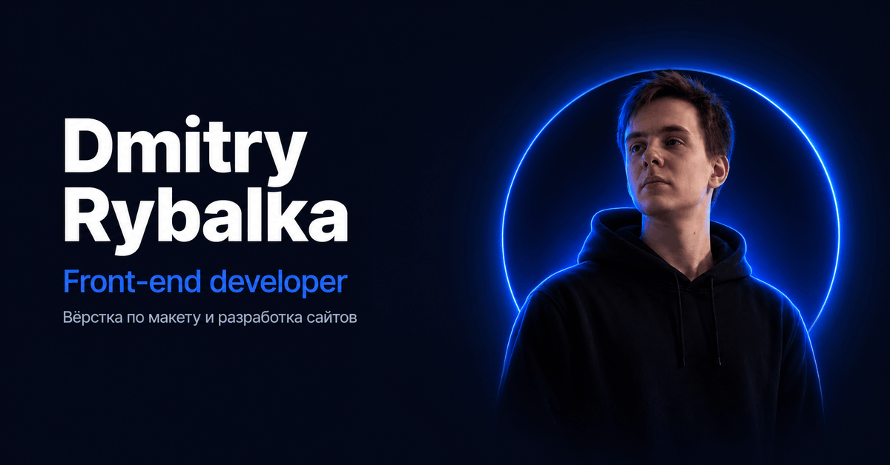

<div align="center">

# Dmitry Rybalka — Portfolio

Сайт-визитка фронтенд-разработчика: вёрстка по макету и разработка сайтов.

**[Открыть сайт](https://dmitry192-del.github.io/portfolio-site/)**



</div>

---

## О проекте

Адаптивная одностраничная визитка без фреймворков и сборщиков: чистые HTML, CSS и JavaScript. Сайт показывает, кто я, что умею и какие проекты уже сделал.

## Возможности

- **Две темы.** Тёмная и светлая, выбор запоминается в браузере. Переключение сопровождается круговой анимацией (View Transitions API), с запасным вариантом для браузеров без её поддержки и для тех, кто отключил анимации.
- **Адаптивная вёрстка.** Рассчитана на компьютер, планшет и телефон, на телефоне есть бургер-меню.
- **Слайдер проектов.** Стрелки и свайп пальцем, карточки привязываются к краю (scroll snap).
- **Умная навигация.** Подсветка текущего раздела при прокрутке, шапка прячется и возвращается, сверху линия прогресса прокрутки.
- **Лёгкий код.** Без библиотек, один обработчик прокрутки через `requestAnimationFrame`, фото в WebP.
- **Доступность и SEO.** Семантическая разметка, `aria`-атрибуты, мета-теги и превью ссылки (Open Graph).

## Стек

| Что | Чем |
| --- | --- |
| Разметка | HTML5 |
| Стили | CSS3: переменные, Grid, Flexbox, методология BEM |
| Логика | JavaScript (ES6+), без библиотек |
| Шрифт и иконки | Inter (Google Fonts), Devicon |
| Хостинг | GitHub Pages |

## Структура

```
portfolio-site/
├── index.html
├── styles/
│   └── style.css
├── js/
│   └── script.js
└── images/
    ├── photo.webp
    ├── og.png
    ├── favicon.svg
    └── projects/
```

## Запуск локально

Сборка не нужна. Достаточно скачать проект и открыть `index.html` в браузере.

```bash
git clone https://github.com/Dmitry192-del/portfolio-site.git
cd portfolio-site
```

Если пользуешься VS Code, удобнее запустить через расширение **Live Server**: страница будет обновляться при сохранении.

## Контакты

Открыт к заказам на вёрстку по макету и разработку сайтов.

- Telegram: [@Dmitry_0796](https://t.me/Dmitry_0796)
- Email: dmitrylandrybalka@yandex.ru
- GitHub: [Dmitry192-del](https://github.com/Dmitry192-del)
